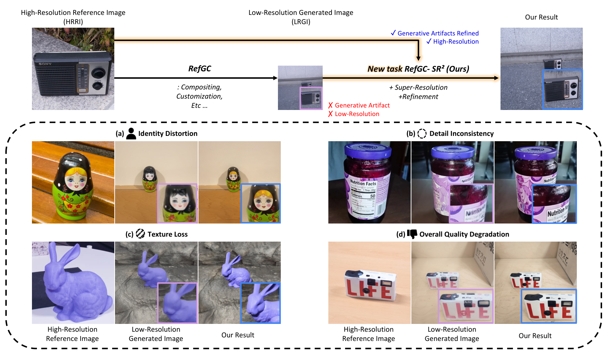
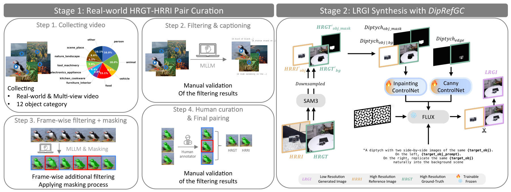
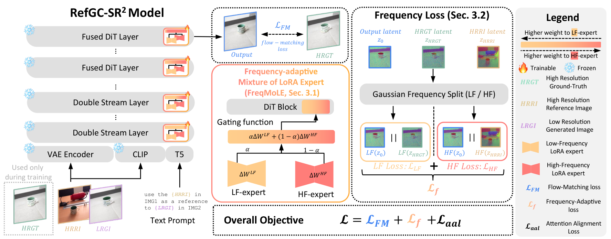

<h1>
  [arXiv'26] RefGC-SR<sup>2</sup>: Reference-guided Super-Resolution and Refinement of AI Generated Content
</h1>

**[Jeahun Sung](mailto:jhseong@cau.ac.kr)**<sup>1*</sup>,
**[Dahyeon Kye](mailto:rpekgus@cau.ac.kr)**<sup>1*</sup>,
**[Soo Ye Kim](mailto:sooyek@adobe.com)**<sup>2†</sup>,
**[Jihyong Oh](mailto:jihyongoh@cau.ac.kr)**<sup>1†</sup>
<br>
<sup>1</sup>CMLab, Chung-Ang University &nbsp; <sup>2</sup>Adobe Research
<br>
<sup>*</sup>Equal contribution (co-first authors), <sup>†</sup>Co-corresponding authors

[](https://cmlab-korea.github.io/RefGC-SR2/)
[](https://arxiv.org/abs/2606.15158)
[](https://arxiv.org/pdf/2606.15158)

This is the official repository for **"RefGC-SR²: Reference-guided Super-Resolution and Refinement of AI Generated Content."**




**RefGC-SR²** reuses the original high-resolution reference image to jointly refine generative artifacts and upscale a low-resolution generated image. The examples illustrate identity distortion, detail inconsistency, texture loss, and overall quality degradation. Figure 1 from the [paper](https://arxiv.org/pdf/2606.15158).

---

## News

- **2026.10.06**: The [arXiv paper](https://arxiv.org/abs/2606.15158) is released.
- **TBD**: Code release.
- **TBD**: Dataset release.

---

<details>
<summary><b>Abstract (Summary)</b></summary>

Reference-guided generation (e.g., object compositing, customization) has progressed rapidly, yet current pipelines share a fundamental limitation: the object-centric high-resolution reference image (HRRI) provided by users is downsampled to a fixed low-resolution (LR) before being fed into the model, so the fine-grained details are discarded before the output is even produced. In addition, the generation step then introduces its own artifacts (e.g., identity distortion) on top of this loss. Existing reference-guided generated content refinement (RefGCR) methods can correct some of these artifacts but still operate in the LR domain; reference-guided super-resolution (RefSR) methods recover resolution but assume natural-image degradations and ignore the artifact distribution of generative pipelines. To address both gaps in a single formulation, we introduce a new task: reference-guided generated content super-resolution-refinement (RefGC-SR2), where the original HRRI is reused at the post-processing stage to recover lost details, refine generative artifacts, and upscale the output simultaneously. We construct the first real-world triplet data generation pipeline for this RefGC-SR2 task, training a diptych-conditioned generator to synthesize paired low-quality anchors that public pretrained models cannot provide. We further present a frequency-aware diffusion transformer model for RefGC-SR2 that selectively injects fine details from the HRRI while removing generative artifacts. Extensive experiments demonstrate that our RefGC-SR2 model successfully (i) refines the object identity faithfully with respect to the reference, and (ii) recovers high-resolution details, so that the final result is significantly higher quality and practically more usable compared to existing RefGCR and RefSR baselines.
</details>

<details open>
<summary><b>Method Overview</b></summary>



**Figure 2. Dataset construction.** We curate high-resolution reference (HRRI) and ground-truth (HRGT) pairs from real-world multi-view videos through filtering, masking, and human validation. **DipRefGC** combines reference appearance with ground-truth pose conditions to synthesize low-resolution generated images (LRGIs), forming pose-consistent triplets with generative artifacts for supervised training.



**Figure 4. Model overview.** Frozen image and text encoders provide the inputs to a frozen **FLUX-Kontext** backbone with trainable **FreqMoLE** modules. Frequency-adaptive supervision uses ground-truth structure and reference details to jointly refine generative artifacts and increase resolution.

See the [paper](https://arxiv.org/pdf/2606.15158) for details.

</details>

---

## Code Release

**TBD.** Installation instructions, pretrained checkpoints, and training, inference, and evaluation commands are pending the code release.

| Resource | Status |
| --- | --- |
| Source code | TBD |
| Environment setup | TBD |
| Pretrained checkpoints | TBD |
| Training / inference / evaluation | TBD |

---

## Dataset

The **RefGC-SR² dataset** consists of HRRI-HRGT-LRGI triplets. Real-world reference and ground-truth pairs are curated from multi-view videos. **DipRefGC**, our diptych-conditioned generator, synthesizes pose-aligned LRGIs containing generative artifacts, enabling supervised refinement and super-resolution.

**Dataset download and preparation instructions: TBD.**

---

## Results

Visit the [project page](https://cmlab-korea.github.io/RefGC-SR2/) for interactive comparisons, benchmark results, and examples on generated content from Gemini, ChatGPT, and Qwen-Image. See the [paper](https://arxiv.org/pdf/2606.15158) for experiments and ablation studies.

---

## Citation

```bibtex
TBD
```
